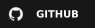
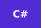
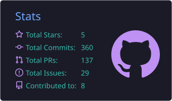
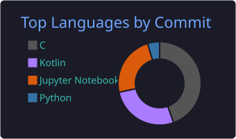

# Olá 👋, Eu sou o Alan

🚀 **Desenvolvedor Full Stack C#/.NET & Angular**  
📍 Brasil 🇧🇷

Desenvolvo **aplicações web completas**, do back-end ao front-end, com foco em **APIs robustas em .NET** e **interfaces modernas em Angular**.  
Busco sempre escrever **código limpo, bem estruturado e de fácil manutenção**, pensando em **performance, segurança e nas necessidades do negócio**.

Também tenho base em **C, C++ e Python** e **Machine Learning**, o que amplia minha visão para resolver problemas de diferentes formas.

---

## 🌐 Onde me encontrar

  
  

---

## 🧠 O que eu faço

-   🧩 Clean Architecture
-   🔐 APIs seguras & autenticação
-   🤖 Automações & integrações
-   📊 Dashboards & análise de dados

---

## 🛠️ Tech Stack

### Frontend

### Backend

### DevOps & Ferramentas

### Outras linguagens & Machine Learning

---

## 📊 GitHub Stats

  
  

