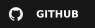
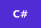
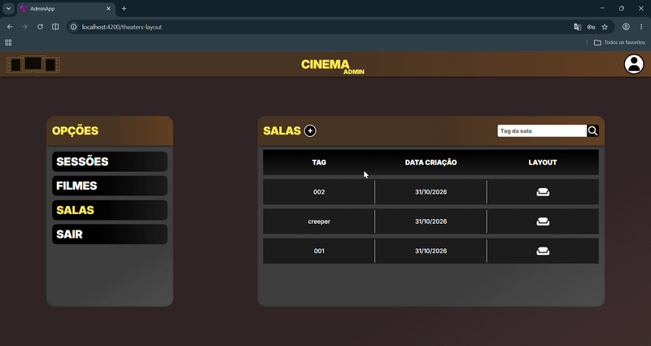
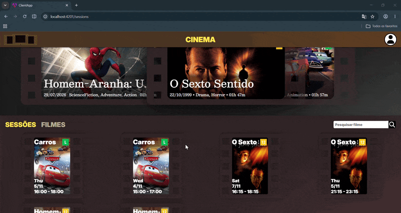
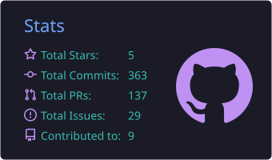
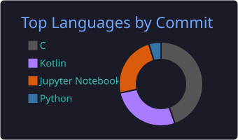

# Olá 👋, Eu sou o Alan

🚀 **Desenvolvedor Full Stack C#/.NET & Angular**  
📍 Brasil 🇧🇷

Desenvolvo **aplicações web completas**, do back-end ao front-end, com foco em **APIs robustas em .NET** e **interfaces modernas em Angular**.  
Busco sempre escrever **código limpo, bem estruturado e de fácil manutenção**, pensando em **performance, segurança e nas necessidades do negócio**.

Também tenho base em **C, C++ e Python** e **Machine Learning**, o que amplia minha visão para resolver problemas de diferentes formas.

---

## 🌐 Onde me encontrar

  
  

---

## 🧠 O que eu faço

-   🧩 Clean Architecture
-   🔐 APIs seguras & autenticação
-   🤖 Automações & integrações
-   📊 Dashboards & análise de dados

---

## 🛠️ Tech Stack

### Frontend

### Backend

### DevOps & Ferramentas

### Outras linguagens & Machine Learning

---

## 🚀 Projetos em destaque

### 🎬 [Cinema](https://github.com/Alan-TC/CinemaProject)

Sistema de gestão de salas, sessões e reserva de assentos para cinemas, com um **painel administrativo** para os operadores e um **portal do cliente** para a compra de ingressos.  
Monorepo **Angular** com biblioteca compartilhada, APIs **.NET** modulares com autenticação **JWT/Argon2**, **PostgreSQL** e ambiente 100% **Docker**.

| Admin: criação do layout da sala | Cliente: página inicial |
| :---: | :---: |
|  |  |

🔗 [Repositório](https://github.com/Alan-TC/CinemaProject) · 🎨 Protótipos no Figma: [Admin](https://www.figma.com/proto/rPx6aaQAXAmOOL14dFfmov/Cinema-Prototype?node-id=329-3855&p=f&t=1gT3icZgjJyrZtk7-1&scaling=scale-down&content-scaling=fixed&page-id=325%3A4029&starting-point-node-id=329%3A3855) · [Cliente](https://www.figma.com/proto/rPx6aaQAXAmOOL14dFfmov/Cinema-Prototype?node-id=66-105&p=f&t=zHL5UMHc9tNe5LjY-1&scaling=scale-down&content-scaling=fixed&page-id=2%3A2&starting-point-node-id=66%3A105&show-proto-sidebar=1)

---

## 📊 GitHub Stats

  
  

